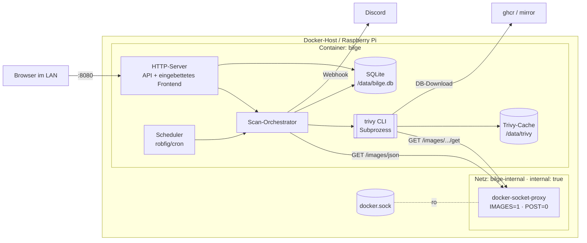

# bilge – Architektur

> Status: Entwurf v0.1 · Stand: 2026-10-22
> Grundlage: [SPEC.md](SPEC.md). Anforderungs-IDs (z. B. F-SCAN-1) verweisen dorthin.

## 1. Überblick



bilge ist **ein Go-Prozess** mit drei Verantwortungen:

1. **HTTP-Server** – liefert die React-App aus und stellt eine JSON-API bereit.
2. **Scheduler** – löst den täglichen Lauf aus.
3. **Scan-Orchestrator** – führt einen Lauf aus (SPEC §5): DB-Update, Images listen, Trivy aufrufen, speichern, vergleichen, benachrichtigen.

Trivy ist ein **externes Binary** im selben Container und wird pro Image als Subprozess gestartet. Es spricht selbst über `DOCKER_HOST` mit dem Proxy, um das Image zu exportieren.

## 2. Leitprinzipien

- **Wenige Abhängigkeiten.** Standardbibliothek zuerst (`net/http` mit Pattern-Routing, `log/slog`, `database/sql`, `os/exec`, `embed`). Externe Go-Module nur: `modernc.org/sqlite`, `github.com/robfig/cron/v3`.
- **Kein Docker-SDK.** Für zwei lesende Endpunkte reicht ein kleiner HTTP-Client; das offizielle SDK bringt viele transitive Abhängigkeiten mit.
- **Klare Schnittstellen an den Rändern.** Docker, Trivy, Discord und Uhrzeit stehen hinter kleinen Interfaces, damit der Orchestrator ohne echte Infrastruktur testbar ist.
- **Ein Schreiber.** Nur der Orchestrator und die Ignore-/Trigger-Endpunkte schreiben; SQLite im WAL-Modus genügt.
- **Fehler pro Image isolieren.** Ein kaputtes Image beendet nie den ganzen Lauf.

## 3. Repository-Struktur

```
bilge/
├── cmd/bilge/            main.go: Config laden, Komponenten verdrahten, Signale
├── internal/
│   ├── config/           Env-Variablen parsen und validieren
│   ├── docker/           minimaler Engine-API-Client (Images listen)
│   ├── trivy/            Subprozess-Aufruf, JSON-Typen, Parser, DB-Update
│   ├── store/            SQLite: Verbindung, Migrationen, Queries
│   │   └── migrations/   0001_init.sql, … (per embed eingebettet)
│   ├── scan/             Orchestrator: Lauf, Diff („neu“), Ignore-Auswertung
│   ├── notify/           Discord-Webhook: Nachricht bauen, kürzen, senden
│   ├── scheduler/        Wrapper um robfig/cron, nächster Lauf
│   └── api/              HTTP-Handler, JSON-DTOs, SPA-Auslieferung
├── web/                  React + Vite + TypeScript
│   ├── src/
│   ├── embed.go          //go:embed all:dist
│   └── dist/             Build-Ausgabe (Platzhalter-index.html eingecheckt)
├── docs/                 SPEC, ARCHITECTURE, ROADMAP
├── compose.yml           Beispiel-Deployment mit socket-proxy
├── Dockerfile
├── Makefile
└── CLAUDE.md
```

`web/dist/index.html` ist als Platzhalter eingecheckt, damit `go build` und `go test` ohne Frontend-Build funktionieren. Der echte Build überschreibt ihn; `web/dist/` ist ansonsten in `.gitignore`.

## 4. Komponenten

### 4.1 `config`

- Liest alle Variablen aus SPEC §8 in ein `Config`-Struct.
- Validiert (Cron-Ausdruck parsebar, Dauern gültig, Severity bekannt, Webhook-URL ist `https://discord.com/api/webhooks/…` oder `https://discordapp.com/…`).
- Gibt beim Start alle Werte aus, die Webhook-URL nur maskiert (NF-SEC-7).

### 4.2 `docker`

```go
type Client interface {
    ListImages(ctx context.Context) ([]Image, error)
}

type Image struct {
    ID       string    // sha256:…
    RepoTags []string  // leer bei dangling
    Created  time.Time
    Size     int64
}
```

- HTTP über `DOCKER_HOST` (`tcp://` und für lokale Entwicklung `unix://`).
- Nutzt eine feste API-Version im Pfad (z. B. `/v1.43/images/json`), damit kein Versionsabgleich nötig ist.
- `<none>:<none>`-Tags werden zu leerer `RepoTags`-Liste normalisiert.

### 4.3 `trivy`

```go
type Scanner interface {
    UpdateDB(ctx context.Context) (DBInfo, error)
    Scan(ctx context.Context, imageRef string) (Report, error)
}
```

**DB-Update**
```
trivy image --download-db-only      --cache-dir /data/trivy
trivy image --download-java-db-only --cache-dir /data/trivy   # wenn BILGE_JAVA_DB
trivy version --format json --cache-dir /data/trivy           # → DBInfo
```

**Scan**
```
trivy image
  --image-src docker
  --scanners vuln
  --format json
  --quiet
  --skip-db-update
  --skip-java-db-update
  --cache-dir /data/trivy
  --timeout <BILGE_SCAN_TIMEOUT>
  <imageRef>
```

- Aufruf über `exec.CommandContext` mit Argument-Liste (NF-SEC-6), Timeout per Context (F-SCAN-3). Trivy hat zusätzlich ein eigenes Standard-Timeout von 5 min; `--timeout` wird deshalb auf denselben Wert gesetzt, sonst bricht Trivy große Images auf dem Pi vorzeitig ab.
- Docker-Endpunkte, die Trivy über den Proxy aufruft (Spike, lokal bestätigt): `HEAD /_ping`, `GET /images/{ref}/json`, `GET /images/{ref}/history`, `GET /images/get`. Alle fallen unter `IMAGES=1` bzw. die Proxy-Standards.
- Umgebung: `DOCKER_HOST` durchreichen, optional `GOMEMLIMIT`, `TMPDIR=/data/tmp` (Trivy schreibt beim Image-Export temporäre Dateien; diese sollen auf das Volume, nicht in RAM/tmpfs).
- Niedrige Priorität per `syscall.Setpriority` direkt nach dem Start des Prozesses (das distroless-Image enthält kein `nice`-Binary).
- Beim Abbruch wird die gesamte Prozessgruppe beendet (`SysProcAttr.Setpgid`), damit keine Kindprozesse zurückbleiben.
- stdout = JSON-Report, stderr wird bei Fehler gekürzt (max. 4 KB) als Fehlermeldung gespeichert.
- Der Parser bildet nur benötigte Felder ab: `Metadata.ImageID`, `Metadata.OS`, `Results[].Target`, `Results[].Class`, `Results[].Type`, `Results[].Vulnerabilities[]` mit `VulnerabilityID`, `PkgName`, `InstalledVersion`, `FixedVersion`, `Severity`, `Status`, `Title`, `PrimaryURL`.
- **Scan-Ziel:** die volle Image-ID (`sha256:…`); im Spike lokal bestätigt. In jedem Fall wird `Metadata.ImageID` gegen die erwartete ID geprüft (Schutz gegen Tag-Wechsel während des Laufs).

### 4.4 `store`

- `modernc.org/sqlite`, DSN mit `journal_mode(WAL)`, `busy_timeout(5000)`, `foreign_keys(1)`.
- Migrationen als nummerierte SQL-Dateien, per `embed` eingebettet, Version in `PRAGMA user_version`. Kein Migrations-Framework.
- Plain SQL in Go-Funktionen; kein ORM.
- Ein Paket-API pro Aggregat, z. B. `store.Runs`, `store.Images`, `store.Findings`, `store.Ignores`.

### 4.5 `scan` (Orchestrator)

```go
type Orchestrator struct {
    docker  docker.Client
    trivy   trivy.Scanner
    store   *store.Store
    notify  notify.Notifier
    clock   func() time.Time
    mu      sync.Mutex      // höchstens ein Lauf (F-SCAN-2)
    progress atomic.Pointer[Progress]
}

func (o *Orchestrator) Run(ctx context.Context, trigger Trigger) (RunID, error)
func (o *Orchestrator) TryStart(trigger Trigger) (RunID, error) // ErrAlreadyRunning
func (o *Orchestrator) Progress() *Progress
```

Ablauf entspricht SPEC §5. Zusätzlich:

- **Diff (SPEC §6.4):** reine Funktion `NewFindings(images, findings, seen) []NewFinding`, ohne I/O, ausgiebig tabellengetestet.
- **Ignores (SPEC F-IGN-2):** reine Funktion `IsIgnored(finding, imageRepos, rules) bool`. Repository = `RepoTag` ohne `:tag` (Achtung bei Registry-Ports wie `host:5000/app:1.0`; der letzte `:` nach dem letzten `/` trennt den Tag).
- Fortschritt (Image x von y, aktuelles Image) wird im Speicher gehalten und über die API abgefragt.
- Beim Start: Läufe mit Status `running` → `aborted` (NF-OPS-6).

### 4.6 `notify`

```go
type Notifier interface {
    Notify(ctx context.Context, summary RunSummary) error
}
```

- Discord-Implementierung mit Embeds: ein Embed pro Image (max. 10 pro Nachricht), Farbe nach höchster Severity.
- Discord-Limits beachten: Embed-Beschreibung ≤ 4096 Zeichen, Gesamttext ≤ 6000 Zeichen, ≤ 10 Embeds. Kürzung mit „… und N weitere“ (F-NOT-3).
- Retry mit Backoff bei 5xx/Netzwerkfehler; bei HTTP 429 wird `retry_after` beachtet (F-NOT-6).
- `NoopNotifier`, wenn kein Webhook gesetzt ist.

### 4.7 `scheduler`

- `robfig/cron/v3` mit `cron.WithLocation(time.Local)` (aus `TZ`).
- Ruft `Orchestrator.TryStart(TriggerSchedule)` auf; `ErrAlreadyRunning` wird geloggt, nicht als Fehler behandelt.
- Liefert den nächsten geplanten Zeitpunkt für die Status-Anzeige.

### 4.8 `api`

`net/http` mit Go-Pattern-Routing. Alle Antworten JSON; Fehler als `{"error": "…"}`.

| Methode & Pfad | Zweck |
|---|---|
| `GET /api/status` | letzter Lauf, nächster Lauf, Fortschritt, Trivy-DB-Stand, Notifier aktiv? |
| `GET /api/images?minSeverity=&fixable=&showIgnored=` | Übersicht mit Severity-Zählern nach Filtern |
| `GET /api/images/{id}` | Image-Metadaten, letzter Scan inkl. Fehler |
| `GET /api/images/{id}/findings?minSeverity=&fixable=&showIgnored=` | Findings des aktuellen Stands, mit `ignored`-Flag |
| `GET /api/runs?limit=` | vergangene Läufe |
| `POST /api/runs` | Lauf manuell starten → 202 oder 409 |
| `GET /api/ignores` | alle Ignore-Regeln |
| `POST /api/ignores` | Regel anlegen `{cve, scope?, reason?}` |
| `DELETE /api/ignores/{id}` | Regel löschen |
| `POST /api/notify/test` | Testnachricht an Discord |
| `GET /healthz` | 200, wenn DB erreichbar |
| `GET /*` | eingebettete SPA; unbekannte Pfade → `index.html` |

Filterung findet **serverseitig in SQL** statt, damit die Zähler in der Übersicht konsistent sind (F-FILT-4) und der Browser keine tausenden Findings laden muss.

Schreibende Endpunkte prüfen `Content-Type: application/json`; das verhindert einfache Cross-Site-Formular-Posts aus dem Browser (Schutz trotz fehlender Auth, NF-SEC-4).

## 5. Datenmodell

```sql
CREATE TABLE runs (
    id              INTEGER PRIMARY KEY,
    trigger         TEXT NOT NULL,          -- schedule | manual | first_start
    status          TEXT NOT NULL,          -- running | succeeded | partial | failed | aborted
    started_at      TIMESTAMP NOT NULL,
    finished_at     TIMESTAMP,
    db_version      TEXT,
    db_updated_at   TIMESTAMP,
    images_total    INTEGER NOT NULL DEFAULT 0,
    images_failed   INTEGER NOT NULL DEFAULT 0,
    new_findings    INTEGER NOT NULL DEFAULT 0,
    notify_error    TEXT,
    error           TEXT
);

CREATE TABLE images (
    id              TEXT PRIMARY KEY,       -- sha256:…
    repo_tags       TEXT NOT NULL,          -- JSON-Array
    created_at      TIMESTAMP,
    size_bytes      INTEGER,
    first_seen_at   TIMESTAMP NOT NULL,
    last_seen_at    TIMESTAMP NOT NULL,
    removed_at      TIMESTAMP               -- F-IMG-4
);

CREATE TABLE scans (
    id              INTEGER PRIMARY KEY,
    run_id          INTEGER NOT NULL REFERENCES runs(id) ON DELETE CASCADE,
    image_id        TEXT NOT NULL REFERENCES images(id) ON DELETE CASCADE,
    status          TEXT NOT NULL,          -- succeeded | failed | timeout
    started_at      TIMESTAMP NOT NULL,
    duration_ms     INTEGER,
    os              TEXT,
    error           TEXT
);
CREATE INDEX scans_image_latest ON scans(image_id, status, started_at DESC);

CREATE TABLE findings (
    id                INTEGER PRIMARY KEY,
    scan_id           INTEGER NOT NULL REFERENCES scans(id) ON DELETE CASCADE,
    vuln_id           TEXT NOT NULL,
    pkg_name          TEXT NOT NULL,
    installed_version TEXT NOT NULL,
    fixed_version     TEXT NOT NULL DEFAULT '',
    severity          TEXT NOT NULL,
    severity_rank     INTEGER NOT NULL,     -- 4=CRITICAL … 0=UNKNOWN, für Filter/Sortierung
    status            TEXT,
    title             TEXT,
    primary_url       TEXT,
    target            TEXT NOT NULL,
    UNIQUE (scan_id, vuln_id, pkg_name, installed_version, target)
);
CREATE INDEX findings_scan_sev ON findings(scan_id, severity_rank DESC);

CREATE TABLE ignores (
    id          INTEGER PRIMARY KEY,
    vuln_id     TEXT NOT NULL,
    scope       TEXT NOT NULL DEFAULT '',   -- '' = global, sonst Repository ohne Tag
    reason      TEXT NOT NULL DEFAULT '',
    created_at  TIMESTAMP NOT NULL,
    UNIQUE (vuln_id, scope)
);

CREATE TABLE seen_findings (                -- SPEC §6.4
    subject        TEXT NOT NULL,           -- repo:tag oder Image-ID
    vuln_id        TEXT NOT NULL,
    pkg_name       TEXT NOT NULL,
    first_seen_at  TIMESTAMP NOT NULL,
    PRIMARY KEY (subject, vuln_id, pkg_name)
);
```

Der „aktuelle Stand“ eines Images (SPEC §6.3) ist der neueste `scans`-Eintrag mit `status = 'succeeded'`.

## 6. Frontend

- **Stack:** React, Vite, TypeScript, `react-router` für drei bis vier Routen. Kein UI-Framework, schlichtes CSS (CSS-Variablen, hell/dunkel über `prefers-color-scheme`).
- **Datenzugriff:** dünner `fetch`-Wrapper mit typisierten API-Funktionen in `src/api.ts`; die TypeScript-Typen spiegeln die Go-DTOs (manuell gepflegt, klein genug).
- **Filter in der URL** (`?minSeverity=HIGH&fixable=1`) über `useSearchParams` (F-UI-6 / F-FILT).
- **Fortschritt:** Während eines Laufs pollt die Status-Leiste `/api/status` alle 3 s, sonst nicht.
- **Routen:** `/` Übersicht · `/images/:id` Detail · `/runs` Läufe · `/ignores` Ignore-Regeln.
- **Entwicklung:** `vite dev` mit Proxy von `/api` auf das Go-Backend (`:8080`).

## 7. Build & Deployment

### 7.1 Dockerfile (Multi-Stage)

1. **web** – `node:<lts>-alpine`: `npm ci && npm run build` → `web/dist`.
2. **build** – `golang:<version>-alpine`: `web/dist` hineinkopieren, `CGO_ENABLED=0 go build -trimpath -ldflags "-s -w"`; Cross-Compile über `TARGETARCH`, Build-Stage läuft auf `$BUILDPLATFORM` (schnell, keine Emulation).
3. **trivy** – `aquasec/trivy:<gepinnte Version>` nur als Quelle für das Binary.
4. **runtime** – `gcr.io/distroless/static-debian12:nonroot` (enthält CA-Zertifikate und `tzdata`): `bilge` + `trivy`, `USER nonroot`, `VOLUME /data`, `HEALTHCHECK` über `bilge healthcheck` (Subkommando, da kein `curl` im Image).

Multi-Arch-Build über `docker buildx` für `linux/arm64,linux/amd64`; Veröffentlichung auf GHCR per GitHub Actions.

### 7.2 Compose-Beispiel (`compose.yml` im Projekt-Root)

```yaml
services:
  socket-proxy:
    image: tecnativa/docker-socket-proxy:<version>
    environment:
      IMAGES: 1
      POST: 0
    volumes:
      - /var/run/docker.sock:/var/run/docker.sock:ro
    networks: [bilge-internal]
    read_only: true
    tmpfs: [/run]
    restart: unless-stopped

  bilge:
    image: ghcr.io/michaelmrt/bilge:latest
    environment:
      DOCKER_HOST: tcp://socket-proxy:2375
      TZ: Europe/Berlin
      BILGE_DISCORD_WEBHOOK_URL: ${BILGE_DISCORD_WEBHOOK_URL:-}
    volumes:
      - bilge-data:/data
    ports:
      - "8080:8080"
    networks: [bilge-internal, default]   # default: Internet für Trivy-DB + Discord
    read_only: true                       # beschreibbar ist nur /data (inkl. /data/tmp)
    security_opt: [no-new-privileges:true]
    cap_drop: [ALL]
    depends_on: [socket-proxy]
    restart: unless-stopped

networks:
  bilge-internal:
    internal: true

volumes:
  bilge-data:
```

Der Proxy hängt **nur** am internen Netz (NF-SEC-2). bilge braucht zusätzlich das Standard-Netz für Port-Publishing und ausgehende Verbindungen.

## 8. Teststrategie

| Ebene | Was | Wie |
|---|---|---|
| Unit | Diff, Ignore-Matching, Repo-Parsing, Severity, Config-Validierung, Discord-Kürzung | Tabellengetriebene Go-Tests, reine Funktionen |
| Parser | Trivy-JSON | Echte Trivy-Reports als Fixtures in `internal/trivy/testdata/` |
| Adapter | Docker-Client, Discord | `httptest.Server` |
| Store | Queries, Migrationen | SQLite in `t.TempDir()` |
| Orchestrator | Lauf inkl. Fehlerfällen | Fakes für `docker.Client`, `trivy.Scanner`, `notify.Notifier` |
| API | Handler | `httptest` gegen echten Store mit Testdaten |
| Frontend | Filter-Logik, Formatierung | Vitest (nur wo Logik steckt) |
| End-to-End | Gesamtsystem | `compose.yml` lokal + Smoke-Test-Skript |

## 9. Bekannte Risiken

| Risiko | Gegenmaßnahme |
|---|---|
| Trivy braucht über den Proxy mehr Endpunkte als erwartet | Spike in Phase 0, bevor Code entsteht |
| Trivy-Speicherspitzen auf dem Pi (OOM) | Sequenzielle Scans, `nice`, `GOMEMLIMIT`, Doku zu Swap/RAM |
| Große Volumes durch Java-DB und Layer-Cache | `BILGE_JAVA_DB` abschaltbar, Größen dokumentieren |
| Änderungen im Trivy-JSON-Format | Trivy-Version im Dockerfile pinnen, Parser-Fixtures bei Upgrade erneuern |
| Dashboard versehentlich öffentlich | Deutlicher Hinweis im README, Reverse-Proxy-Beispiel |
